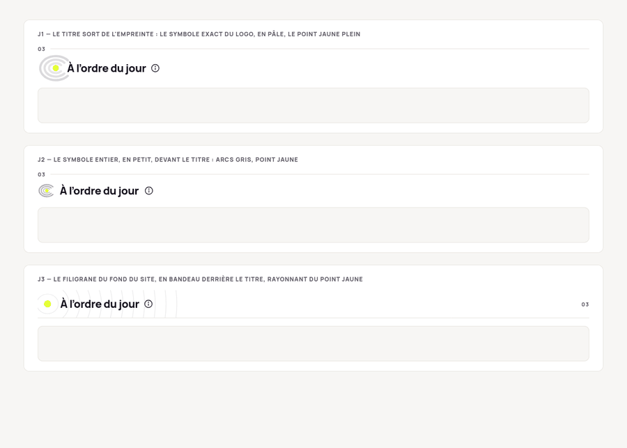
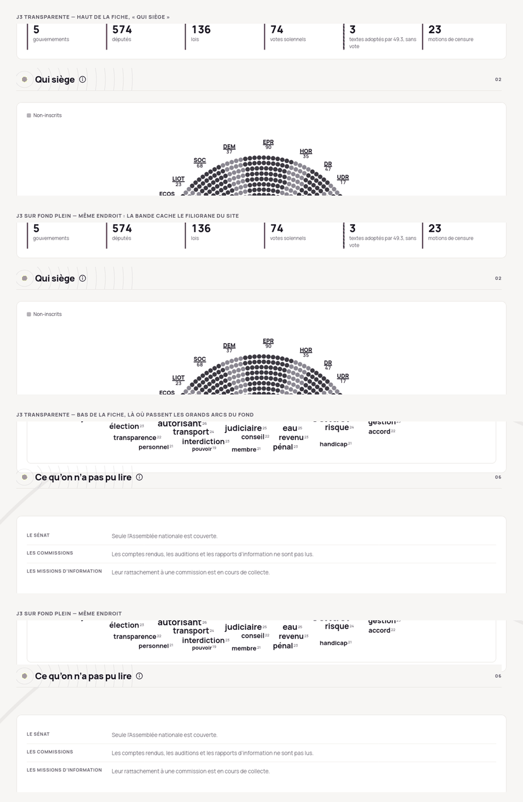

# Titres de section : le surligné jaune quitte les fiches, l'empreinte en filigrane le remplace (J3) (2026-10-27)

`2026-10-27`

> **En bref** — Le surligné jaune fluo sous les titres de section ressemble à la charte du parti Place Publique, ce qu'un site qui refuse tout jugement politique ne peut pas se permettre. Après une exploration d'une quarantaine de formes, les 26 et 27/10/2026, la propriétaire a retenu **J3** : des cercles d'empreinte très fins derrière le titre, rayonnant d'un point jaune, fermés par un trait fin. Ce fichier garde les prérequis, chaque famille explorée avec son visuel, et les refus avec leur raison, pour qu'aucune ne soit reproposée. L'implémentation reste à faire, et une question n'est pas tranchée : la bande de J3 transparente ou sur fond plein.

## Le problème

Les titres de section des quatre fiches portent un surligné jaune `#dfff00` sous le
texte (`linear-gradient(transparent 62%, var(--accent) 62%)`), dans
`GovernmentProfile.css` (`.gvp-section-titre > span`, lu aussi par la fiche de
législature), `CandidateProfile.css`, `LigneeProfile.css` et `ParolesParPeriode.css`.
Le 26/10/2026, la propriétaire a remarqué que ce geste rappelle la charte de Place
Publique : « C'est pas bon du tout ça ! » (AGENTS.md §2 règle 1).

## Les prérequis, dans ses mots

| Prérequis | Sa formulation |
| --- | --- |
| Une image de marque | « il s'agit en quelque sorte de l'image de la marque qui doit être unique et reconnaissable » |
| Une touche de jaune fluo | « j'aimerai garder une touche de la couleur fluo » |
| Subtil et harmonieux | Refus de la bande noire : « Ça manque de subtilité. Le rendu n'est pas harmonieux » |
| Pas littéral | « on ne va pas mettre le logo avec chaque titre de section […] C'est trop littéral » |
| Cohabiter avec le fond | « comment est-ce que ça va se superposer avec le fond en arrière plan » |
| Des formes distinctes | « fait des propositions qui se distinguent des autres » |
| Pas une police | « Non la police, ça ne marche pas » |

Le fond de page porte déjà un filigrane d'ellipses concentriques (`styles/shell.css`),
étiré sur toute la hauteur de la page : sur une fiche de 5 000 px, ce sont de grandes
bandes courbes très pâles. Toute forme se juge par-dessus.

## La décision : J3

Des ellipses concentriques fines (encre, trait 1,2 px, opacité 0,09) rayonnent d'un
point jaune `#dfff00` placé à gauche du titre, dans une bande de la largeur de la
colonne et de 56 px de haut, fermée par un trait de 1 px `#e7e4df`. Le numéro de
section passe à droite. Le titre et sa bulle restent en encre.

**Non tranché — à décider à l'essai sur une fiche entière** : la bande transparente,
où les cercles de J3 croisent les grands arcs du fond, ou sur fond plein `#f7f6f4`,
qui masque le filigrane du site sous la bande.

## Ce qui a été exploré

Chaque famille a été posée sur des captures réelles de la fiche de la XVIIe
législature. La maquette complète est l'artefact
https://claude.ai/artifact/LGqqsL2a7GUxW1mDGRrymZ (privé).

| Famille | Visuel | Son verdict |
| --- | --- | --- |
| A à D — le surligné actuel, le titre seul, un soulignement noir, le numéro gris devant | [01](img/signature-titres-de-section/01-formes-A-a-D.png) | Sans jaune, donc écartées : elle veut « garder une touche de la couleur fluo » |
| E à G — numéro sur pastille jaune, segment jaune au début du trait, carré jaune devant le titre | [02](img/signature-titres-de-section/02-touche-de-fluo-E-a-G.png) | « Tu n'as pas autre chose ? » |
| H, I, J — formes tirées du symbole du logo | [03](img/signature-titres-de-section/03-symbole-H-I-J.png) | H : « ressemble à des boobs ! » ; J « peut-être mais en plus clean ou structuré » |
| J1 à J3 — l'empreinte en filigrane | [04](img/signature-titres-de-section/04-filigrane-J1-a-J3.png) | **J3 : « J'aime bien »**, retenue le 27/10 |
| Bande noire, filigrane blanc | [06](img/signature-titres-de-section/06-bande-noire.png) | « Ça manque de subtilité. Le rendu n'est pas harmonieux » |
| K1, K2 — le point et ses ondes ; le trait qui naît du point | [07](img/signature-titres-de-section/07-K1-K2.png) | K1 « trop littéral » ; K2 « peut-être » |
| K3 à K5 — le trait de séparation avec un point jaune placé autrement | [08](img/signature-titres-de-section/08-K3-a-K5.png) | Trop semblables : « fait des propositions qui se distinguent des autres » |
| L1 à L4 — point final jaune, onglet, sillons, grand numéro au trait | [09](img/signature-titres-de-section/09-L1-a-L4.png) | L3 (sillons) « peut-être » ; les autres non retenues |
| M1 à M3 — les sillons déclinés | [10](img/signature-titres-de-section/10-sillons-M1-a-M3.png) | M1 et M3 « peut-être » |
| Six formes retenues côte à côte | [11](img/signature-titres-de-section/11-six-formes-retenues.png) | — |
| Six polices de titre | [12](img/signature-titres-de-section/12-polices.png) | « Non la police, ça ne marche pas » |
| N1 à N5 — rang, fil, bifurcation, filet, silhouette de carte (sous-agent) | [13](img/signature-titres-de-section/13-N1-a-N5.png) | N1 et N3 retenues pour approfondissement |
| P1 à P6 — N1 et N3 approfondies (second sous-agent) | [14](img/signature-titres-de-section/14-P1-a-P6.png) | Vues, puis J3 retenue |

## Ce qu'il ne faut pas reproposer

- **Toute bande de jaune sous le texte**, y compris un trait jaune sous le titre (M3) :
  c'est le geste du surligneur, celui qu'on quitte.
- **Le logo répété** devant ou derrière chaque titre (H, I, J1, J2, K1).
- **Un aplat noir**, et plus généralement un aplat qui sépare le titre du fond.
- **Une police de titre** différente de Manrope.
- **Un motif centré et symétrique** autour d'un point : il se lit comme un œil, ou
  comme une cible, malvenu sur un site qui regarde des élus.
- Des variantes qui ne diffèrent que par la place d'un point jaune.

Écartées en route par les sous-agents, au rendu, sans être montrées : crêtes en arche
(œil, onde sonore), crêtes verticales (code-barres), contours d'angle de carte
(viseur), crochet jaune (hameçon), éventail de crêtes (balai, lignes de vitesse),
glyphes d'empreinte par section (connotation de fichage policier).

## Ce qui reste

- **La variante de J3** : transparente ou sur fond plein, sur une fiche entière en
  local.
- **L'implémentation sur les quatre fiches**, d'un seul tenant : les quatre règles CSS
  citées plus haut, et `DESIGN_SYSTEM.md` §5. Sur téléphone (390 px), J3 n'a pas été
  vérifiée.
- **Le surligné du mot recherché** dans les textes (`.xd-mot` dans
  `ExtraitsDuDebat.css`, l'étiquette de `Recherche.css`) porte le même geste. C'est un
  usage fonctionnel, à trancher à part.

Non vérifié : la ressemblance avec la charte de Place Publique est le constat de la
propriétaire ; aucune comparaison avec d'autres chartes de partis n'a été faite.
